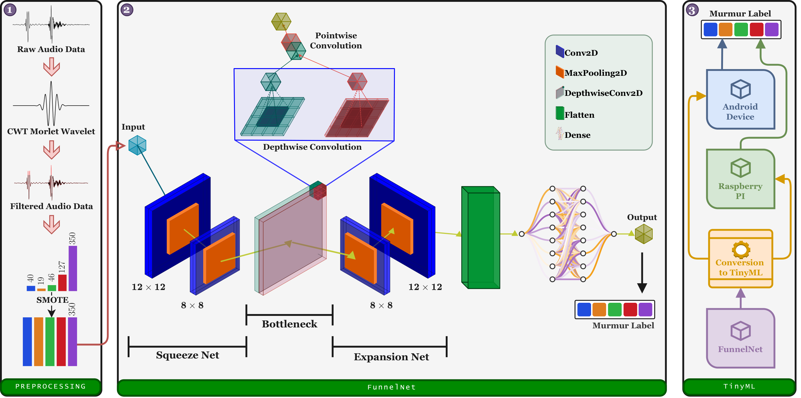

# FunnelNet

Code for the paper "FunnelNet: An End-to-End Deep Learning Framework to Monitor Digital Heart Murmur in Real-Time".

## Abstract

Heart murmurs are abnormal sounds caused by turbulent blood flow in the heart. Existing diagnostic methods, including cardiac auscultation, echocardiography, and phonocardiography (PCG), have limitations related to training requirements, accessibility, cost, and noise interference. This study proposes an end-to-end real-time heart murmur detection approach using traditional and depthwise separable convolutional networks. We applied a Butterworth filter and Continuous Wavelet Transform (CWT) to remove noise and extract meaningful features from PCG data. The proposed FunnelNet consists of three parts: a Squeeze net for compressed feature representation, a Bottleneck layer using depthwise-separable convolutions to reduce computational complexity, and an Expansion net to recover fine details. We evaluated the model on the publicly available CirCor pediatric heart sound dataset. With only ~5.4k parameters, FunnelNet achieved 85% accuracy, 85% sensitivity, and 92% specificity, outperforming several larger models. We further converted the network to TensorFlow Lite for TinyML deployment on resource-constrained devices. The model achieved an average real-time inference accuracy of 91% on a Raspberry Pi 4B and 80% on an Android smartphone.

## Overview



*Fig: An illustration of the proposed FunnelNet network architecture, divided into three parts: the squeeze net, the bottleneck, and the expansion net. The Squeeze and Expansion networks work like an encoder and decoder to compress and upscale the most relevant input features. A depthwise CNN has been employed at the Bottleneck for reduced computational complexity. A fully connected layer is placed at the end to predict the correct class.*

## Folder structure

| Path | Content |
|---|---|
| `src/` | Model, data loading, signal processing and training utilities |
| `data_create.py` | Builds the processed dataset (`data/<dataset>.npz`) from the audio files |
| `tuner.py` | Hyperparameter search |
| `train.py` | Cross-validated training, evaluation and TFLite conversion |
| `config.yml` | All settings (dataset, learning rate, epochs, folds, ...) |
| `run_train.sh` | Runs `train.py` inside the conda environment |
| `eda.ipynb` | Notebook used to make the figures |
| `rpi_inference.py` | Inference script for the Raspberry Pi |
| `android-src/` | Android application |
| `fastapi-server/` | Server-side API |

## Data

The audio comes from the public [CirCor DigiScope dataset](https://doi.org/10.13026/G02K-A047) on PhysioNet. It is not included in this repository. Download it and place the wav files and `training_data.csv` in `dataset/circor/`.

## How to run

1. Create the environment:

   ```bash
   conda env create -f environment.yml
   conda activate fn
   ```

2. Build the processed data:

   ```bash
   python data_create.py
   ```

3. Train:

   ```bash
   python train.py
   ```

   Settings such as the learning rate, epochs, folds and the SMOTE / outlier-removal switches are in `config.yml`. Any setting can also be overridden on the command line, for example `python train.py --run.epoch 250 --run.smote true`.

4. Optional: `python tuner.py` runs the hyperparameter search.

The trained model is saved under `logs/` and, with `tflite: true`, converted to a TensorFlow Lite model for the Raspberry Pi and Android app.

## License

See [LICENSE](LICENSE).
